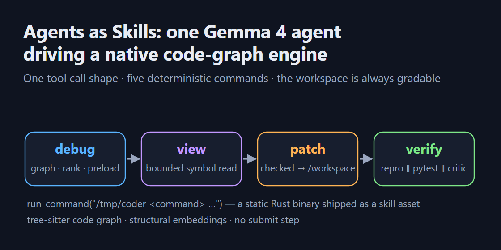

# Agents as Skills

One Gemma 4 agent driving a native code-graph engine. This repository holds the agent described in our
paper-track write-up for the Kaggle *Gemma 4 Developer Agent* competition: the engine source, the skill that
ships it, the system prompt, the configuration, and the scripts that turn them into the ADK submission package.



The agent is a single ADK `LlmAgent` with one tool, `run_command`. Every model turn is one string:

```
run_command("/tmp/coder <command> key=value ... <<'EOF'
<multi-line text>
EOF")
```

`/tmp/coder` is a statically linked Rust binary that travels inside the submission as a skill asset. It has five
commands:

| Command | What it does |
|---|---|
| `debug query='...'` | builds a tree-sitter code graph of the repository, ranks files and functions, lists the files that change together with the target, returns the code to edit |
| `view file=... symbol=...` | bounded read of a symbol, a line range, the imports or a file outline |
| `patch file=... symbol=...` | applies an edit quoted as `<<<OLD … === … >>>`, repairs small slips, refuses edits that break the file, writes through to `/workspace` |
| `verify` | runs the reproducer, the tests paired with the changed code and a static critic in parallel, answers with one verdict |
| `probe` | runs a Python snippet outside the repository |

There is no submit step: the harness grades `/workspace` as it stands when the session ends.

## Layout

```
agent/knobs.toml          configuration of the agent version (model, budgets, sampling, tools, call shape)
agent/prompt.md           the system prompt, with {{agent_minutes}} and {{max_tool_calls}} placeholders
engine/                   the Rust crate `swe-coder` (the /tmp/coder engine)
skill/swe-coder/          the ADK skill: SKILL.md and the Python entry scripts (boot.py installs /tmp/coder)
tools/build_engine.sh     builds the static x86_64-musl binary in Docker and packs it
tools/pack_engine.py      packs a binary into the text asset (LZMA + base85)
tools/generate.py         renders the submission package from the knobs
tests/smoke.sh            end-to-end check of the generated package, without a model
```

## Generate the agent

Requirements: Docker, Python 3.11 or newer, a POSIX shell (Git Bash works on Windows). No GPU.

```bash
# 1. build the engine and pack it        -> build/swe-coder, build/swe_coder.txt
bash tools/build_engine.sh

# 2. render the ADK package              -> build/submission/  and  build/submission.zip
python tools/generate.py --zip --check

# 3. check that it works end to end      (prints SMOKE OK)
bash tests/smoke.sh
```

Step 1 compiles the crate in `rust:1.99.1-alpine` with `--locked` and static linking. To build without Docker
on Linux, install the target (`rustup target add x86_64-unknown-linux-musl`), run

```bash
cd engine
RUSTFLAGS="-C target-feature=+crt-static -C link-arg=-s" \
  cargo build --release --locked --target x86_64-unknown-linux-musl --bin swe-coder
cd .. && python tools/pack_engine.py engine/target/x86_64-unknown-linux-musl/release/swe-coder
```

Step 2 writes this tree:

```
build/submission/
  agent.yaml                  one LlmAgent, tool run_command, skill skills/swe-coder
  eval_config.yaml            the per-task budget the scorer reads
  configs/sampling.yaml       temperature, top_p, thinking budget
  prompts/system.md           the prompt with the budget filled in
  skills/swe-coder/SKILL.md
  skills/swe-coder/scripts/   boot.py, _boot.py, _budget.py and the per-command entry scripts
  skills/swe-coder/assets/swe_coder.txt     the packed engine
```

`build/submission.zip` is what the competition notebook uploads. `--check` compares the generated
`agent.yaml`, `eval_config.yaml`, `configs/sampling.yaml`, `prompts/system.md`, `SKILL.md` and `_budget.py` with
the sha256 of a reference package and reports whether the engine asset is the same binary. It applies to the
knobs as committed; after you change them, run without `--check`.

Step 3 starts a `python:3.12` container, creates a small repository with one bug in `/workspace`, and plays the
calls a model would make: `boot.py`, `debug`, `view`, a `verify` on the unedited tree (must answer `EMPTY DIFF`),
a syntactically broken `patch` (must be refused and leave the file intact), the correct `patch`, and a final
`verify` (must answer `VERDICT: READY`). It then checks that the diff touches one source file and that the
repository's tests pass. The transcript is printed, so you can read what the model would see.

## Change the agent

Edit `agent/knobs.toml` and run step 2 again.

| Knob | Effect |
|---|---|
| `agent.model` | the Gemma 4 variant (`gemma-4-e4b-it-qat-w4a16-ct` here) |
| `budget.max_time_minutes`, `budget.max_tool_calls` | the per-task budget; the engine scales its checkpoints, warnings and reserve with these |
| `sampling.*` | temperature, top_p, presence penalty, output and thinking budgets |
| `agent.tools` | `["run_command"]`; add `"submit_patch"` and the engine tells the model to submit after `READY` |

`agent/prompt.md` is the whole system prompt. `{{agent_minutes}}` is the budget minus half a minute, rounded
down.

After a change under `engine/src`, run all three steps. The crate has its own tests: `cd engine && cargo test`
(they need `git` and `python3` on the path).

## Try the engine by hand

After step 2, in any Linux x86_64 environment with Python 3 and git:

```bash
cd /path/to/a/python/repository          # the engine treats /workspace, or $SWE_WS, as the task repository
SWE_WS=$PWD python3 /path/to/build/submission/skills/swe-coder/scripts/boot.py
/tmp/coder debug query='ClassName.method the exact error text'
/tmp/coder view file=pkg/mod.py symbol=ClassName.method
```

State is kept in `/tmp/.agent/` (index, saved reproducer, snapshots of original files, `best.patch`, the session
clock). Delete that directory to start a new session.

## What is and is not here

Here: everything needed to build the agent package and to exercise the engine on CPU.

Not here: the competition harness, the model weights, the task data and our evaluation tooling. Running the agent
with a model needs the competition's ADK harness and a served Gemma 4; this repository stops at the package the
harness loads.

The engine indexes Python only, and `verify` assumes `pytest`.

## License

Apache-2.0, see [LICENSE](LICENSE).
